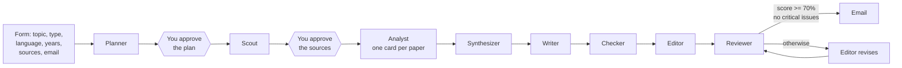

# n8n Scientific Writer

An n8n pipeline of AI agents that finds open-access papers, reads them, writes a scientific text, checks every citation and reviews the result. A text passes review at 70% or more with no critical issues; otherwise it goes back to the Editor for revision. You approve the research plan and the sources in web forms; the article comes by email.

Every agent follows a skill from [mcroitor/agent-skills-library](https://github.com/mcroitor/agent-skills-library).

## What you get

The email has four attachments:

| File | Content |
|---|---|
| `article.md` | The text with numeric ISO 690:2022 citations and a reference list |
| `references.bib` | BibTeX for every cited work |
| `review.md` | A 25-criterion review with the weighted score |
| `sources-and-cards.md` | The sources with links and one analysis card per paper |

Article types: literature review (about 3000-4000 words), related work section (1200-1800), IMRAD article draft (4000-5000). Language: English (default) or Romanian.

The text is a machine draft. Check it before you use it.

## How it works



The Editor gets at most 2 revision rounds. After that the email goes out anyway and lists the critical issues that are still open.

### Agents

| Agent | Skill | Tool | Job |
|---|---|---|---|
| Planner | problem-decomposer | | Research question, search queries, outline with word targets |
| Scout | scientific-paper-analyst | `search_openalex` | Finds and screens open-access papers |
| Analyst | scientific-paper-analyst | `fetch_fulltext` | Reads the PDF (or the abstract) and fills a paper card |
| Synthesizer | research-synthesizer | | Findings by theme, confidence levels, a brief for the Writer |
| Writer | research-writing-assistant | | Writes the text with `[@key]` citation markers |
| Checker | scientific-writing-editor | `crossref_lookup` | Checks every claim against the cards and every reference in Crossref |
| Editor | scientific-writing-editor, academic-manuscript-editor | `crossref_lookup` | Fixes the issues, ISO 690:2022 references, BibTeX |
| Reviewer | scientific-paper-reviewer | | 25-criterion review, weighted score, critical issues, top fixes |

Each agent's instructions, model, skills and tools are in [`agents/`](agents).

### Tool workflows

| Workflow | Used by | What it does |
|---|---|---|
| `SW · Search OpenAlex` | Scout | OpenAlex search, open access only, compact records with abstracts |
| `SW · Fetch full text` | Analyst | Downloads a PDF and returns its text; on failure returns `ok: false` and the agent uses the abstract |
| `SW · Crossref lookup` | Checker, Editor | Crossref metadata by DOI or title, trimmed for ISO 690 and BibTeX |

## Repository layout

```text
workflows/
├── scientific-writer-agents.json   # main pipeline: form, agents, review gate, email
├── sw-search-openalex.json         # tool: OpenAlex search
├── sw-fetch-full-text.json         # tool: PDF text
└── sw-crossref-lookup.json         # tool: Crossref metadata
agents/
└── 01-planner.json ... 08-reviewer.json
```

## Requirements

- n8n 2.46 or newer with n8n Agents.
- An OpenAI-compatible model endpoint. We run `qwen3.8:27b` on Ollama behind nginx; any model with tool calling and structured output should work.
- An SMTP account for the email.
- For PDF parsing, the n8n host CPU must support AVX2. On Proxmox, set the VM CPU type to `x86-64-v3` or `host`. Without AVX2, n8n crashes with exit code 132 on the first PDF.

## Setup

1. **Credentials.** Create an OpenAI credential with your endpoint as the base URL (for Ollama: `http://<host>:11434/v1`) and an SMTP credential.
2. **Tool workflows.** Import the three `workflows/sw-*.json` files and publish them. Note their IDs.
3. **Agents.** For each file in `agents/`, create an n8n Agent:
   - name, model and instructions from the file;
   - the skills listed in `skills` from the library (each entry links to its folder);
   - the workflow tools listed in `tools`, pointing to the workflows from step 2;
   - the OpenAI credential from step 1.

   Publish every agent. A form run fails with "Agent is not published" otherwise.
4. **Main workflow.** Import `workflows/scientific-writer-agents.json`, select the agent in each agent node, set the SMTP credential and the sender address in **Email Result**, then publish.
5. Open the form at `https://<your-n8n>/form/scientific-writer-agents`.

### Placeholders

The JSON files contain no secrets. Instance-specific values are replaced with placeholders:

| Placeholder | Replace with |
|---|---|
| `REPLACE_WITH_<ROLE>_AGENT_ID` | the ID of that agent (in the agent nodes) |
| `REPLACE_WITH_<NAME>_WORKFLOW_ID` | the ID of that tool workflow (in agent tools) |
| `REPLACE_WITH_OPENAI_COMPATIBLE_CREDENTIAL_ID` | your OpenAI-compatible credential |
| `REPLACE_WITH_SMTP_CREDENTIAL_ID` | your SMTP credential |
| `noreply@example.org` | your sender address |

## Using it

1. Fill in the form: topic, article type, language, years, number of sources (default 15), your email.
2. **Step 1 of 2.** The plan opens in the same tab after a couple of minutes. Continue, stop, or add search queries.
3. **Step 2 of 2.** The source list opens after 5-15 minutes. Continue, stop, or drop papers by number.
4. Close the tab. Writing, checking and review take 30-90 minutes; the result comes by email.

A typical run with 15 sources and `qwen3.8:27b` takes 2-5 hours, most of it reading papers and revision rounds.

## Limitations

- Only open-access papers. A paper without a reachable PDF is analyzed from its abstract.
- The full-text tool reads PDFs only; HTML pages fall back to the abstract.
- An IMRAD draft has no original data: its methods and results describe the analyzed literature.

## Authors

- Mihail Croitor ([@mcroitor](https://github.com/mcroitor), mcroitor@gmail.com)
- Nichita Nartea ([@devrdn](https://github.com/devrdn), nichita.nartea@gmail.com)
- Claude (Anthropic)

Agent skills: [mcroitor/agent-skills-library](https://github.com/mcroitor/agent-skills-library).
